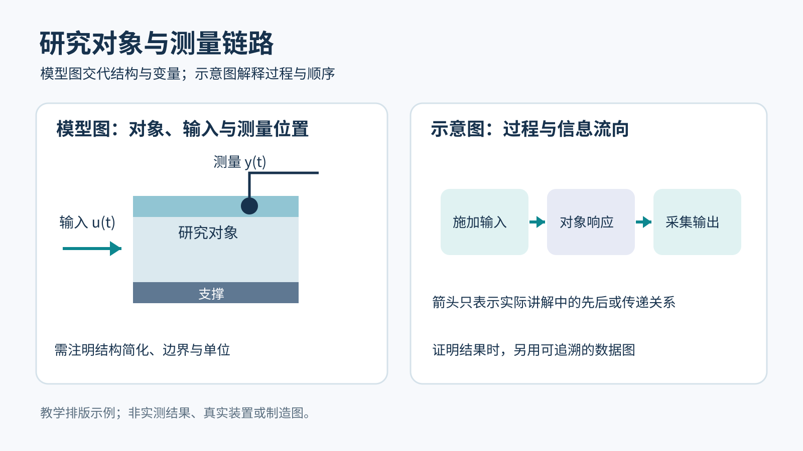

# Well-Designed PPT Skill

用于制作和实质修改演示文稿的 Codex skill。重点处理 AI 制作 PPT 时常见的字号过小、页面拥挤、图片机械、公式失真和套话过多等问题，尤其适合课程讲解、研究汇报与工程展示。

## 轻量结构

```text
well-designed-ppt/
├── SKILL.md                              # Agent 默认读取的入口
├── agents/openai.yaml                    # 技能展示信息
├── references/
│   ├── slide-design.md                   # 页面设计与图像选择；新稿或大改时读取
│   ├── stem-content-and-evidence.md      # 理工科内容与证据；按需读取
│   └── stem-slide-qa.md                  # 渲染与技术验收；按需读取
├── assets/
│   ├── slide-roles.svg                   # 模型图与示意图搭配的原创教学示例
│   └── slide-plan.json                   # 复杂多页任务的可选规划表
├── scripts/check_pptx.py                 # 只读的 PPTX 基础检查工具
├── .gitignore
└── README.md
```

入口保持简短，不设置多层路由。简单任务直接执行；参考资料、规划表和检查脚本只在需要时使用。

## 安装与调用

将本仓库放入支持 skill 的 Agent 技能目录，文件夹命名为 `well-designed-ppt`，并保持内部相对路径。例如放在 `$CODEX_HOME/skills/well-designed-ppt/`。

```text
使用 $well-designed-ppt，根据提供的资料制作一份课堂汇报 PPT。
一页只讲一个主题，搭配模型图、示意图和必要的原始证据图，
最后检查字号、公式、标题、图片类型和最终渲染。
```

```text
使用 $well-designed-ppt，修改现有 PPT 中的结果部分。
保留其他页面，拆分内容过密的页，并核对相关公式、图例和结论。
```

## 制作原则

- 每页一个主题，要点不超过 5 条；标题至少 32 pt、正文至少 24 pt。空间不够时先精简或拆页。
- 标题短而准确，语言平实、书面化；删除“说透”“拆开来看”“逻辑闭环”等套话。
- 原始图和数据图承担证据；示意图解释过程，模型图交代结构、变量和条件。图的来源与作用要清楚。
- 公式依据可信来源重新录入并逐项核对。AI 内容只作初稿，正式汇报前由人定稿。
- 逐页渲染检查，并按“字号 → 每页主题 → 公式 → 语句 → 标题 → 图片类型”完成终检。

详细执行要求见 [SKILL.md](SKILL.md)。用户当前要求和指定模板优先。

## 参考与示例



上图仅展示一页中两类图的不同作用，非真实实验、实测结果或固定版式。实际任务的模型结构应来自可靠资料，证据图应来自真实数据或可追溯来源。

| 文件 | 何时使用 |
| --- | --- |
| [页面设计与图像选择](references/slide-design.md) | 新稿、大幅改版或图像角色不清楚时 |
| [内容与证据参考](references/stem-content-and-evidence.md) | 理工科资料需要组织论证、核对模型与证据时 |
| [渲染与技术验收](references/stem-slide-qa.md) | 技术图、公式、数据或已有课件需要细查时 |
| [逐页规划表](assets/slide-plan.json) | 长篇或来源复杂的汇报；复制到任务目录填写 |

## 可选检查工具

`scripts/check_pptx.py` 使用 Python 3 标准库，只读取 PPTX 并报告显式设置的小字号、带标记的项目符号数量和页数。它无法检查主题继承字号、图片内文字、遮挡、公式正确性或实际投影效果；最终仍需打开并逐页查看。

```sh
python scripts/check_pptx.py presentation.pptx
python scripts/check_pptx.py presentation.pptx --json review.json
```

仓库只发布通用方法、原创教学示例和可选的只读工具，不包含编写过程中使用的完整课件、私人数据或第三方论文图片。

